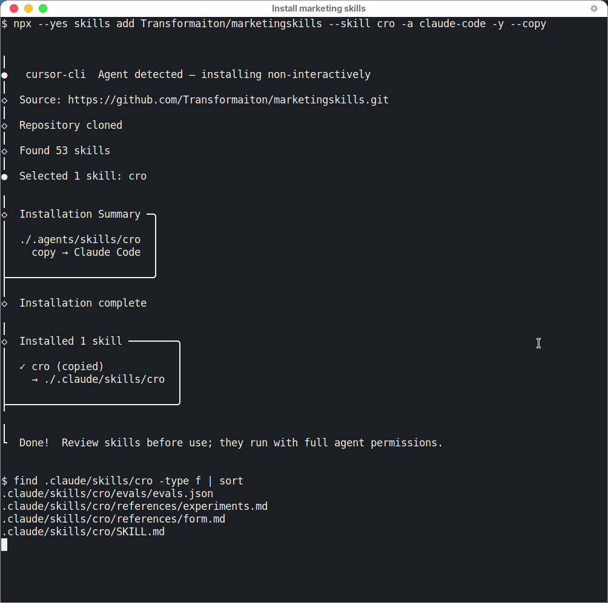

# Marketing Skills by Transformaiton.com

A free set of marketing instructions for AI agents, published by [Transformaiton.com](https://transformaiton.com/) for small-business owners and the people who help them.

You describe a job in plain English — review a landing page, write a welcome email series, check local search, draft an ad. The agent reads the matching skill and follows a practical marketing workflow: what to ask, what to decide, and what to hand back. The skills cover conversion, copy, SEO, analytics, and growth.

The instructions were written by [Corey Haines](https://github.com/coreyhaines31) and are used here under the MIT license. See [Credits](#credits).



*Real install, photographed on 16 November 2026. The command in the window is `npx --yes skills add Transformaiton/marketingskills --skill cro -a claude-code -y --copy`. It cloned this repository, found 53 skills, and copied cro to `.claude/skills/cro`. The "cursor-cli" line is the installer noticing Cursor on that computer. `-a claude-code` is what selected Claude Code.*

## What the skills are

A skill is a folder of markdown instructions. It is not a separate app, and it does not log into your website, email tool, or ad account by itself.

When a skill is installed, your AI agent can recognize a marketing request and apply that skill's checklist. One skill is the foundation: [product-marketing](skills/product-marketing/) records who you serve, what you sell, and how you should sound. The other skills look for that note before they draft.

You can install all 53 skills, or only the ones you need. Full steps are in [docs/INSTALL.md](docs/INSTALL.md). How to ask for work is in [docs/USAGE.md](docs/USAGE.md).

## Which AI tools they work with

The skills follow the open [Agent Skills](https://agentskills.io) format. This copy supports the same install paths as the original project:

| Tool | How you install |
|------|-----------------|
| [Claude Code](https://code.claude.com/docs/en/skills) | Terminal command or the Claude Code plugin, below |
| Claude on the web | Upload a single-skill ZIP from the original project's releases |
| [OpenAI Codex](https://developers.openai.com/codex/skills) | Codex plugin marketplace |
| Cursor, Windsurf, GitHub Copilot, and other coding agents | The same terminal command, with the agent name |
| [Perplexity Computer](https://www.perplexity.ai/help-center/en/articles/13914413-how-to-use-computer-skills) | Upload a single-skill ZIP from the original project's releases |
| Any agent that reads Agent Skills | Copy the `skills/` folder into that agent's skills directory |

You keep using whichever AI product you already pay for. Transformaiton.com does not receive the conversation. The files in this repository do not run a service.

## Install

You need [Node.js](https://nodejs.org/) 18 or newer for the terminal commands. Claude Code's plugin commands run inside Claude Code and do not need Node. If the terminal is new, send [docs/INSTALL.md](docs/INSTALL.md) to whoever sets up the computers, or email [info@transformaiton.com](mailto:info@transformaiton.com).

Run the commands in the project folder where you want the skills (your website repo, or a new empty folder). To make them available in every project, add `-g` to the `npx skills` command.

### Claude Code (terminal)

1. Install [Claude Code](https://code.claude.com/docs/en/overview) and confirm `claude` opens.
2. In the project folder, install every skill and tell the installer to use Claude Code:

   ```bash
   npx skills add Transformaiton/marketingskills -a claude-code
   ```

3. To install one skill, name it. This is the command in the screenshot, for the landing-page skill:

   ```bash
   npx --yes skills add Transformaiton/marketingskills --skill cro -a claude-code -y --copy
   ```

   `npx --yes` skips the question about downloading the installer. `-y` skips the installer's own confirmation. `--copy` copies the files into the project. Without `--copy`, the installer links back to its download. This is the command in the screenshot above.

4. Check that the files landed in `.claude/skills/`. Claude Code reads that folder. If you run the command from inside a Claude Code chat and forget `-a claude-code`, the installer may only write `.agents/skills/`, which Claude Code does not read. Run the command again with `-a claude-code`.
5. Open Claude Code in that folder and ask for a marketing job, or type a slash command such as `/cro`.

### Claude Code (plugin)

In an interactive Claude Code session:

```text
/plugin marketplace add Transformaiton/marketingskills
/plugin install marketing-skills@marketingskills
```

`/plugin` works in the Claude Code app on your computer. It is not available in Claude on the web or in GitHub Actions. From a normal terminal, the same install is:

```bash
claude plugin marketplace add Transformaiton/marketingskills
claude plugin install marketing-skills@marketingskills
```

### OpenAI Codex

```bash
codex plugin marketplace add Transformaiton/marketingskills
```

Then, inside a Codex session, run `/plugins` and select **marketing-skills**. Later, `codex plugin marketplace upgrade` picks up newer releases of this marketplace.

### Cursor, Windsurf, GitHub Copilot, and other agents

The [skills CLI](https://github.com/vercel-labs/skills) detects agents you have installed. Name one if you want to be specific:

```bash
npx skills add Transformaiton/marketingskills -a cursor
npx skills add Transformaiton/marketingskills -a windsurf
npx skills add Transformaiton/marketingskills -a github-copilot
```

List what is in this repository without installing:

```bash
npx skills add Transformaiton/marketingskills --list
```

[SkillKit](https://github.com/rohitg00/skillkit) can install the same repository across several agents:

```bash
npx skillkit install Transformaiton/marketingskills
npx skillkit install Transformaiton/marketingskills --skill cro copywriting
```

### Copy the folder

```bash
git clone https://github.com/Transformaiton/marketingskills.git
cp -r marketingskills/skills/* .agents/skills/
```

For Claude Code, copy into `.claude/skills/` instead of `.agents/skills/`.

To pin this repository inside another project:

```bash
git submodule add https://github.com/Transformaiton/marketingskills.git .agents/marketingskills
```

The skills then live at `.agents/marketingskills/skills/`.

### Claude on the web, and Perplexity Computer

This GitHub repository does not publish release ZIP files. Single-skill archives are published by the original project: [github.com/coreyhaines31/marketingskills/releases/latest](https://github.com/coreyhaines31/marketingskills/releases/latest). Those archives contain the skill instructions. They do not include this README.

- **Claude on the web.** Download `<name>-claude-web.zip`. In Claude, use **Customize → Skills → + Create skill → Upload a skill**. Account permissions have to allow skills.
- **Perplexity Computer.** Download `<name>-perplexity.zip`. Use **Plugins → Add custom → Skill → Upload skill**.

Details of what each ZIP contains are in [docs/skill-release-packaging.md](docs/skill-release-packaging.md).

### If you still have the old skill names

Version 2 renamed 17 skills and folded page and form conversion work into `cro`. Old folders are not deleted on upgrade. The cleanup commands are in [docs/INSTALL.md](docs/INSTALL.md#upgrading-from-version-1).

## Skill catalog

Descriptions below are one line each, in everyday language. The file in each folder is the full instruction set the agent reads.

### Start here

| Skill | What it does |
|-------|----------------|
| [product-marketing](skills/product-marketing/) | Writes down who you serve, what you sell, and how you should sound. The other skills read this first. |

### Website and landing pages

| Skill | What it does |
|-------|----------------|
| [cro](skills/cro/) | Finds why a page or form is not getting enquiries, and what to change first. |
| [copywriting](skills/copywriting/) | Writes the words for a homepage, landing page, pricing page, or service page. |
| [copy-editing](skills/copy-editing/) | Tightens, proofreads, or refreshes copy you already have. |
| [signup](skills/signup/) | Shortens a signup or free-trial form so more people finish it. |
| [onboarding](skills/onboarding/) | Helps a new customer reach a useful result the first time they use the product. |
| [popups](skills/popups/) | Decides whether a popup will help, and writes one that is easy to close. |
| [paywalls](skills/paywalls/) | Improves the screen that asks a free user to pay, after they have seen the product. |
| [site-architecture](skills/site-architecture/) | Decides which pages you need and how they should link. |
| [schema](skills/schema/) | Adds the hidden labels that tell Google what a page is (a local business, a product, an article). |
| [image](skills/image/) | Creates or resizes images for the site, social posts, and ads. |
| [video](skills/video/) | Plans a demo, ad, or social video, including when an AI video tool is a fit. |

### Getting found

| Skill | What it does |
|-------|----------------|
| [seo-audit](skills/seo-audit/) | Finds why the site is hard to find on Google, including local search for a shop or service area. |
| [ai-seo](skills/ai-seo/) | Works on being named when people ask ChatGPT, Perplexity, or Google's AI answers. |
| [content-strategy](skills/content-strategy/) | Decides what to publish, and which piece to write next. |
| [programmatic-seo](skills/programmatic-seo/) | Plans many useful search pages from one template, such as a page per town or service. |
| [link-building](skills/link-building/) | Earns mentions and links from other sites. It does not buy links. |
| [competitors](skills/competitors/) | Writes a fair "us versus them" or "alternatives" page. |
| [competitor-profiling](skills/competitor-profiling/) | Researches what a competitor charges, claims, and is doing now. |
| [aso](skills/aso/) | Improves an app's title, keywords, and screenshots in the App Store or Google Play. |

### Email, text, and social

| Skill | What it does |
|-------|----------------|
| [emails](skills/emails/) | Writes automated email series: welcome, follow-up, reminder, and win-back. |
| [cold-email](skills/cold-email/) | Writes first-touch emails to people who have not asked to hear from you. |
| [lead-magnets](skills/lead-magnets/) | Chooses a checklist, template, or guide worth trading for an email address. |
| [sms](skills/sms/) | Decides whether text or WhatsApp is worth it, and drafts messages people can reply to. |
| [social](skills/social/) | Plans organic posts for LinkedIn, Instagram, Facebook, TikTok, or X. |
| [community-marketing](skills/community-marketing/) | Starts or grows a group where customers help each other. |

### Ads and numbers

| Skill | What it does |
|-------|----------------|
| [ads](skills/ads/) | Plans or fixes Google, Meta, and LinkedIn ads, including whether ads are worth the spend. |
| [ad-creative](skills/ad-creative/) | Writes and compares ad headlines and text, and retires lines that have gone stale. |
| [conversion-tracking](skills/conversion-tracking/) | Makes sure a real enquiry or sale is what the ad accounts count. |
| [analytics](skills/analytics/) | Sets up or checks analytics so the numbers mean what you think they mean. |
| [attribution](skills/attribution/) | Works out which marketing actually leads to revenue. |
| [ab-testing](skills/ab-testing/) | Plans a fair test, or decides whether a result is real enough to act on. |

### Offers, pricing, and keeping customers

| Skill | What it does |
|-------|----------------|
| [offers](skills/offers/) | Shapes the offer: what is included, the guarantee, and how people can pay. |
| [pricing](skills/pricing/) | Chooses prices and packages, or plans a price increase. |
| [churn-prevention](skills/churn-prevention/) | Reduces cancellations and recovers failed payments. |
| [referrals](skills/referrals/) | Sets up a refer-a-friend or affiliate reward you can afford. |

### Planning and research

| Skill | What it does |
|-------|----------------|
| [marketing-plan](skills/marketing-plan/) | Builds a full plan: who you reach, which channels, and what to do first on a real budget. |
| [marketing-ideas](skills/marketing-ideas/) | Suggests practical ideas when the obvious channels are not enough. |
| [marketing-psychology](skills/marketing-psychology/) | Applies what we know about how people decide, without fake urgency. |
| [marketing-council](skills/marketing-council/) | Gives several expert points of view on one decision before you pick. |
| [customer-research](skills/customer-research/) | Turns interviews, reviews, and comments into what customers actually mean. |
| [marketing-loops](skills/marketing-loops/) | Sets a repeating check, such as a weekly look at search or ads, for an agent to run. |
| [reverse-engineer-marketing](skills/reverse-engineer-marketing/) | Reconstructs how another company grew, from public evidence, and what is safe to copy. |

### Sales, launch, and partners

| Skill | What it does |
|-------|----------------|
| [prospecting](skills/prospecting/) | Builds a list of people worth contacting, and checks the emails before you send. |
| [sales-enablement](skills/sales-enablement/) | Writes the one-pager, deck, or objection answers a sales conversation needs. |
| [revops](skills/revops/) | Decides when a lead is ready for a person to follow up. |
| [launch](skills/launch/) | Plans a launch: timing, the announcement, and the checklist before you go public. |
| [public-relations](skills/public-relations/) | Prepares a pitch to a journalist, or what to say if you are asked for comment. |
| [events](skills/events/) | Decides whether a webinar, booth, or speaking slot is worth the money, and plans it. |
| [co-marketing](skills/co-marketing/) | Finds a partner business and splits the work and the leads. |
| [influencer-marketing](skills/influencer-marketing/) | Chooses creators, agrees what they will post, and what you will pay. |
| [directory-submissions](skills/directory-submissions/) | Lists the product in directories that are worth the time. |
| [free-tools](skills/free-tools/) | Decides whether a free calculator or checker is worth building to attract customers. |

## Example prompts

Swap in your own business. More detail on what to have ready, and what a useful answer looks like, is in [docs/USAGE.md](docs/USAGE.md).

**Landing page review**

```text
Look at our homepage and tell me why a visitor might leave without asking for a quote. We are a three-person plumbing company. We want more booked calls. Use the cro skill. Do not rewrite the whole page until you have listed the problems in priority order.
```

Paste the URL, or paste the page text if the agent cannot open the site.

**Email sequence**

```text
Write a short welcome series for people who joined our bakery's email list to get a coupon: a free coffee with a pastry. Sound like the owner. Tell me how many emails, when each one sends, and the subject line and body for each. Use the emails skill.
```

**Local SEO**

```text
We are a family dental practice with one office. Review our local SEO: Google Business Profile, the pages on our site, and what to fix first. Use the seo-audit skill. Do not invent reviews or rankings. Say what you could not check.
```

**Ad copy**

```text
Write three Google search ads for a mobile dog-grooming van that serves a 15-mile radius. The offer is $20 off the first visit. Do not claim we are the highest rated. Tell me which headline to test first and what to measure. Use the ad-creative skill.
```

## FAQ

**Do I need to know how to code?**
No. After the one-time install, you talk to the agent in plain English. The install itself is a terminal command. If that is unfamiliar, use the plugin steps inside Claude Code, or email us and we will walk through it.

**Will this change my website, send email, or spend money on its own?**
No. A skill tells the agent how to think through the job. You review the draft before anything is published, sent, or paid for.

**Which skill should I start with?**
For a first project, ask the agent to use `product-marketing` and describe the business. After that, name the job. You do not have to memorize the catalog.

**Are the skills free?**
Yes. They are MIT-licensed. You still pay your AI product on its normal plan. Transformaiton.com does not charge for this repository.

**Can I install one skill?**
Yes. Add `--skill` and the name, as in the cro example above.

**The agent ignored the skill. What now?**
Say the skill name in the sentence: "Use the seo-audit skill." In Claude Code you can also type `/seo-audit` when that command is available.

**Do you see what I type?**
No. The chat stays with the AI product you opened. Cloning this repository copies files onto your machine. It does not create an account with us.

**Can the agent read my analytics or ad account?**
Only if you connect that account yourself. The optional setup notes are in [tools/SETUP.md](tools/SETUP.md). Every skill works without a connected account: you paste the numbers or the page.

## Credits

The skill instructions were written by [Corey Haines](https://github.com/coreyhaines31). The original repository is [github.com/coreyhaines31/marketingskills](https://github.com/coreyhaines31/marketingskills).

Copyright (c) 2025 Corey Haines. The [MIT license](LICENSE) is unchanged and is included with this copy.

Transformaiton.com is not affiliated with Corey Haines and is not endorsed by him.

### Modifications by Transformaiton.com

Transformaiton.com publishes this copy for customers. The changes are:

- This README, rewritten for small-business owners, including the catalog, install steps, example prompts, FAQ, and this credit.
- [docs/INSTALL.md](docs/INSTALL.md) and [docs/USAGE.md](docs/USAGE.md).
- Removal of the original personal promotions from the README (newsletter, course, agency, and sponsor advertisements).
- Removal of a tracked Magister promotional link from [skills/ad-creative/SKILL.md](skills/ad-creative/SKILL.md) and from [skills/reverse-engineer-marketing/references/data-sources.md](skills/reverse-engineer-marketing/references/data-sources.md). The marketing steps in those skills are otherwise unchanged.

The other skill files are the original instructions.

## Contact

[Transformaiton.com](https://transformaiton.com/) is an AI consultancy for small businesses.

- Website: [https://transformaiton.com/](https://transformaiton.com/)
- Email: [info@transformaiton.com](mailto:info@transformaiton.com)
- GitHub: [https://github.com/Transformaiton](https://github.com/Transformaiton)

For a problem in the original skill instructions, the upstream project takes issues at [github.com/coreyhaines31/marketingskills/issues](https://github.com/coreyhaines31/marketingskills/issues). For help using this copy, email Transformaiton.com.

## License

[MIT](LICENSE). Copyright (c) 2025 Corey Haines. You can use, copy, and modify the skills. Keep the copyright notice and this license with any substantial copy.
